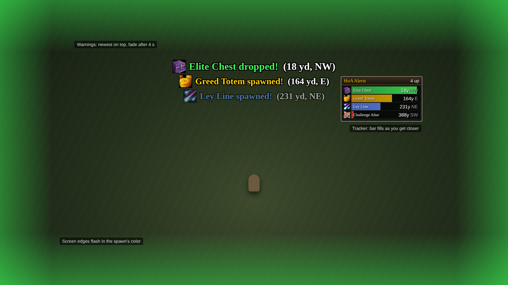

# HoA Alerts

A BigWigs/DBM-style warning addon for **[Hordes of Azeroth](https://github.com/jonhaldors/hordes-of-azeroth)**.
It warns you when one of these appears during a run:

| Alert | Default | Sound |
|---|---|---|
| **Ley Line** | on | Raid warning |
| **Greed Totem** | on | Coin sound |
| **Challenge Altar** | on | Ready check |
| **Elite Chest** (free chest) | on | Quest complete |
| Moonwell | off | Quest list complete |
| Valor Chest (costs Valor) | off | Map ping |

Each warning can:

- show **big text** in the middle of the screen with the spawn's icon, distance and direction (`Ley Line spawned! (230 yd, NE)`)
- play a **sound**
- **flash the screen edges** in the spawn's color
- print a **chat message**
- add the spawn to a small **tracker list** that shows every active spawn, nearest first, with live distance and compass direction (N, NE, E, ...; north is up on the map)

It also **flashes the screen edges red when a ground effect hits you**, meaning you didn't get out of a
telegraphed circle, cone, line, ring, eruption or bolt landing zone in time. Turn it off with `/hoaa ground`.

Warnings pop in, stay for 4 seconds, then fade out over 1 second. Up to three stack, newest on top.



*Mockup of the layout, not an in-game screenshot. Type `/hoaa test` in game to see the real thing.*

## Install

1. Download this repository and copy the `HoAAlerts` folder into the game's AddOns folder.
   Hordes of Azeroth loads addons from **`benilla-config\AddOns`** inside the game folder (not `Interface\AddOns`),
   so you end up with `benilla-config\AddOns\HoAAlerts\HoAAlerts.toc`.
2. Start the game and enable **HoA Alerts** on the character select AddOns screen.
3. In game, type `/hoaa test` to see what the warnings look like.

## Commands

| Command | What it does |
|---|---|
| `/hoaa` | Open the options window |
| `/hoaa test [type]` | Show test warnings |
| `/hoaa unlock` / `/hoaa lock` | Move the warning text and the tracker |
| `/hoaa range <yards>` | Only warn for spawns within that distance (`0` = any) |
| `/hoaa leyline` / `greed` / `altar` / `elite` / `moonwell` / `valor` | Turn one alert type on or off |
| `/hoaa warning` / `sound` / `flash` / `chat` / `tracker` | Turn one kind of output on or off |
| `/hoaa ground` | Turn the red ground-effect hit flash on or off (`/hoaa test ground` to preview) |
| `/hoaa reset` | Reset frame positions |

Settings are saved per account in `HoAAlertsDB`.

## How it works

The Hordes of Azeroth server tells its own addon about every map pin with a hidden system chat line:

```
BONK~objective~<id>~<kind>~<x>~<y>~<mapId>~<label>~<seconds>~<icon>~<description>
BONK~objectiveclear[~<id>]
```

HoA Alerts listens for the same lines. Labels are translated, so it recognizes each spawn
by its pin kind and icon, which are fixed in the server code:

| Spawn | kind | icon |
|---|---|---|
| Ley Line | `shrine` | `Spell_Arcane_StarFire` |
| Greed Totem | `shrine` | `INV_Misc_Coin_02` |
| Challenge Altar | `shrine` | `Ability_Warrior_Challange` |
| Moonwell | `shrine` | `Spell_Arcane_TeleportMoonglade` |
| Free (Elite) Chest | `chest` | `INV_Box_04` |
| Valor Chest | `chest` | `INV_Box_02` |

Pins that the server sends again (for example after `/reload`) don't trigger a second warning.

### Ground-effect hits

Every ground effect in Hordes of Azeroth (telegraphed circles, cones, lines and rings, eruptions,
bolt landing zones) damages you as a direct enemy spell hit. The 1.12 combat log reports that as
`<enemy>'s <spell> hits you for <amount>` (or `crits you`). Enemy melee and damage over time use
different messages, so HoA Alerts flashes red only for those direct spell hits. Several hits within
a third of a second give one flash.

### Notes

- **Elite Chest** covers every *free* chest. Most come from elite kills (15% base chance, more per affix
  and with Luck, guaranteed after 5 elites without one). The server uses the same chest for Challenge
  Altar, event and hidden-find rewards, and the addon can't tell those apart.
- If the game changes these icons or the message format in a later version, update the table at the
  top of `HoAAlerts/HoAAlerts.lua`. This version was written against game version 0.6.4.
- The addon only reads chat and combat-log messages the game already sends to you. It doesn't change the game or send anything to the server.
